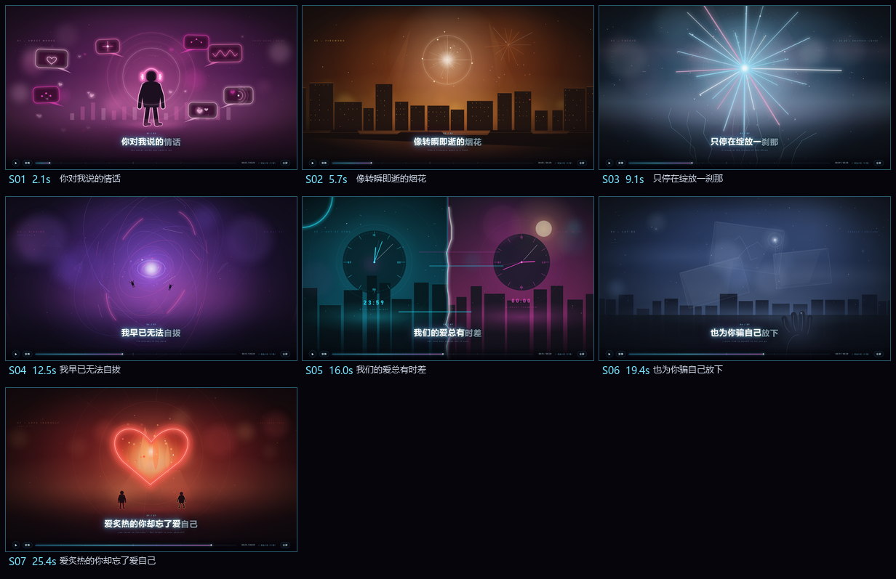

<div align="center">

# 词场 · VerseField

**一句一景，把歌词唱成画面。**
*Every lyric line becomes a scene.*

[](LICENSE)


</div>



## 这是什么

VerseField（词场）是一个 **DSH Skill + 命令行工具**：给一首歌的名字和一段歌词（从哪句到哪句），
它会自动完成：

- **搜歌词 + 逐句时间轴**（QQ 音乐主源 / 网易云备源）
- **找完整音源**（自动多平台搜索，或用你本地的 BGM）
- **对齐校验 + 截取**：人声起音 vs LRC 逐句比对，按起唱点截出用户要的片段
- **分配画面**：按歌词判断——模板只在真正贴合时借用，其余句子单独绘制；每句可写画面概念与画面类型
- **生成单文件网页**：每句歌词一个 SVG 动画场景，离线双击就能播放
- **自动 QA**：场景校验、单文件产物检查、真音频完整播放切点比对、音轨引擎自测

> 在 DSH 会话里只需要说：
> `用 versefield 做《歌名》从「第一句」到「最后一句」`

## 特性

- **按句判断，模板不硬套**：模板不是配额——只有这句的画面构思和某个 motif 真正贴合时才借用（比如歌词真的在写烟花才用 m10），
  其余句子单独绘制；连续套模板或整片套模板时 scaffold 会给出提醒。用户明确要求「尽量原创」时可选强制 ≥70% 的原创模式，
  要求「快速版」时才允许全模板。
- **一句一景**：15 个可复用霓虹场景模板（星空 / 雨窗 / 眼睛海 / 烟花 / 漩涡 / 时钟 / 燃烧的心…）作为参考库，
  整片调色板按歌名自动做色相偏移，同一模板在不同歌里颜色也不同。
- **真实音轨 + 卡点**：从真实音频离线分析 50fps 起音包络，场景里的鼓点、光环、心跳与音乐逐帧对齐。
- **歌词/声音强制校验**：解决“同名单曲≠同一录音”的坑——起音校验 + 时长/版本守卫，不通过不交付。
- **单文件交付**：音频 base64 内联，最终 `index.html` 可离线播放，0 外部请求。
- **淡入淡出**：场景之间默认 0.28s 交叉淡化，片头 / 片尾带黑场淡入淡出（`plan.fade` / `fade_in` /
  `fade_out` 可调或关闭）；导出的 MP4 会一起带上画面与音轨的淡入淡出。
- **成品一眼可见**：生成的交付目录只放 `index.html`、`README.md`、`lyric-video.mp4`；
  `src/`、`tools/`、`assets/` 等工程文件统一收进 `_project/`，删掉也不影响网页播放。
- **可导出 MP4**：生成项目自带 `tools/export-video.mjs`，无头 Chrome 按时间轴逐帧渲染 + ffmpeg 合成音轨
  （不是录屏），默认 30fps/1600×900，可出 50fps/1920×1080，支持只导一段。
- **更快**：视频导出默认多进程并行 + 快速截图（30s 片段约 2 分钟）；QA 一条命令，迭代期 `--fast` 约 20s；
  截图类 QA 改为一次加载逐帧定格，不再逐场景重新导航。
- **可扩展**：场景模板、视觉风格、QA 工具都是独立文件，方便继续加。

## 快速开始

### 方式一：作为 DSH Skill（推荐）

**这个仓库本身就是技能包**：根目录的 `SKILL.md` 就是技能入口。clone / 解压后把整个文件夹放进
DSH 技能目录即可，不需要再找子文件夹。

```bash
# macOS / Linux：直接 clone 到技能目录（文件夹名就是 versefield）
git clone https://github.com/enruiAI/versefield.git ~/.dsh/skills/versefield

# Windows（PowerShell）
git clone https://github.com/enruiAI/versefield.git
New-Item -ItemType Directory -Force "$env:USERPROFILE\.dsh\skills" | Out-Null
Copy-Item -Recurse .\versefield "$env:USERPROFILE\.dsh\skills\versefield"
# 或者进入仓库运行一键安装脚本（自动排除 .git / node_modules）
cd versefield
powershell -ExecutionPolicy Bypass -File .\install.ps1
```

macOS / Linux 也可以用一键安装脚本：

```bash
git clone https://github.com/enruiAI/versefield.git
cd versefield && ./install.sh
```

> **从压缩包安装**：从 [Releases](https://github.com/enruiAI/versefield/releases) 下载
> `versefield-v0.2.1.zip`（或 GitHub 页面上的 “Download ZIP”），解压后把 `versefield/`
> 文件夹整个放进 `~/.dsh/skills/` 即可。如果解压出来是 `versefield-main/`，先改名为 `versefield`。
>
> **确认安装**：`~/.dsh/skills/versefield/SKILL.md` 存在即可，DSH 会自动刷新技能列表。
> **更新**：如果当初是 `git clone` 安装，`git -C ~/.dsh/skills/versefield pull` 即可。
>
> 旧技能名 `lyric-video` 仍然兼容；已安装过旧版的，直接覆盖 `~/.dsh/skills/versefield`（或按上面
> 的方式重新 clone / 解压覆盖）即可，不需要迁移别的文件。

然后在任意 DSH 会话里说：

```text
用 versefield 做《歌名》从「第一句歌词」到「最后一句歌词」，BGM 自动找
```

可选补充：`BGM 用 D:\music\xxx.mp3`、`全部独立场景`、`全部模板`。

### 方式二：命令行流水线

以下命令在仓库根目录（也就是技能目录）执行；作为 DSH Skill 使用时，代理会用绝对路径调用这些脚本。

```bash
# 0) 依赖
pip install numpy imageio-ffmpeg yt-dlp

# 1) 搜歌词 + 逐句时间轴
python scripts/fetch_lyrics.py --song "歌名" --artist "歌手" \
  --first-line "起句" --last-line "止句" --out meta/lyrics.json

# 2) 找完整音源（也可以 --file 指定本地 mp3）
python scripts/fetch_audio.py --song "歌名" --artist "歌手" \
  --expect-duration 171.5 --out assets/full.m4a

# 3) 起音校准 + 截取 + 卡点表
python scripts/align_and_cut.py --audio assets/full.m4a --lyrics meta/lyrics.json \
  --first-line "起句" --last-line "止句" \
  --out-mp3 assets/song_clip.mp3 --out-meta meta/cut.json --pulse-file meta/pulse_table.txt

# 4) 写 plan.json（结构见 docs/plan-schema.md）后生成项目
python scripts/scaffold.py --plan plan.json --out my-lyric-video --build
```

生成目录里直接双击 `index.html` 即可观看。若要在生成项目里跑浏览器 QA：

```bash
npm install --prefix my-lyric-video/tools   # 首次
```

## 工作流

```
歌名 + 歌词起止句
   │
   ├─ fetch_lyrics.py   → 逐句 LRC / lyrics.json
   ├─ fetch_audio.py    → 完整音源（自动搜 / 用户文件 / 链接）
   ├─ align_and_cut.py  → 起音校验 + 截取 + pulse 表 + cut.json
   ├─ 【画面分配】      按语义判断：模板贴合才借用，其余单独绘制；concept 可选
   ├─ scaffold.py       → timeline / scenes / audio-data / tools / README / project.json
   ├─ 【补画 custom】   派场景画师；check-scene + 截图自检
   └─ QA                validate / check-final / check-real-full / test-real-audio / contact-sheet
```

## 内置场景模板（参考库）

> 模板只在某句歌词的画面**真正贴合**时才使用；如果连续/整片都在套模板，scaffold 会提醒你回头确认。
> scaffold 还会按「歌名 + 歌手」自动偏移整套配色，同一个模板在不同歌曲里不会长得一模一样。

| id | 画面 | 适合的歌词意象 |
|---|---|---|
| m01 | 星海与渺小的人 | 星空 / 宇宙 / 渺小 / 孤单 / 两个人 / 远方 |
| m02 | 玻璃星球小世界 | 小世界 / 愿望 / 星球 / 玻璃 / 城市 / 祈愿 |
| m03 | 地平线升起的光 | 光 / 希望 / 遇见 / 日出 / 天亮 / 照亮 |
| m04 | 眼里的大海 | 眼睛 / 海 / 泪 / 看见 / 辽阔 / 蓝 |
| m05 | 天台与拍立得 | 天台 / 城市夜 / 并肩 / 拍立得 / 回忆 / 取代 |
| m06 | 雨夜窗边 | 雨 / 窗 / 发呆 / 陪伴 / 夜晚 / 灰暗 |
| m07 | 拨开阴霾的手 | 拨开 / 云 / 阴霾 / 手 / 光 / 放晴 |
| m08 | 收集与淘汰的机器 | 收集 / 淘汰 / 快乐 / 删掉 / 整理 / 分类 |
| m09 | 耳机与情话气泡 | 情话 / 耳机 / 气泡 / 甜 / 声音 / 告白 |
| m10 | 城市烟花 | 烟花 / 短暂 / 绚烂 / 夜空 / 绽放 |
| m11 | 冻结的烟花 | 一刹那 / 定格 / 冻结 / 瞬间 / 停住 |
| m12 | 漩涡下坠 | 漩涡 / 沉沦 / 无法自拔 / 下坠 |
| m13 | 错位的两只钟 | 时差 / 时钟 / 错位 / 距离 |
| m14 | 松手让光球升起 | 放下 / 松手 / 升空 / 释然 |
| m15 | 燃烧的心 | 心 / 燃烧 / 炙热 / 爱自己 / 火 |

## QA / 质量门禁

每个生成项目自带一套 QA（`_project/tools/`，场景数/时长由 `_project/project.json` 自适应）。
在生成的 `_project/` 目录里执行：

```bash
cd _project
npm install --prefix tools       # 每个新项目首次（约 20s）
node build.mjs                   # 打包，并自动同步 ../index.html
node tools/qa.mjs --fast         # 迭代期一键 QA：约 20s，跳过整片实时播放
node tools/qa.mjs                # 交付前完整 QA：约 片段时长 + 25s
```

`qa.mjs` 依次跑下面这些单项（也可以单独执行）：

```bash
node tools/validate.mjs          # 全部场景：加载 / update / 非法 path / 节点数 / 性能
node tools/check-final.mjs       # 单文件：0 外部请求 / 0 console error / 逐场景截图 + active/lyric
node tools/check-real-full.mjs   # 真音频完整播放：切点误差 / 结束页 / 重播
node tools/test-real-audio.mjs   # 音轨引擎 24 项断言
node tools/check-autoplay-fallback.mjs  # 自动播放被拦 → 海报 + 点击起播
node tools/contact-sheet.mjs     # 全片接触表（_project/shots/）
```

**门禁标准**：`validate.failed=0`、`check-final.summary` 全 true、`check-real-full.allOk=true`、
`test-real-audio` 全过、`grep "TODO — CUSTOM SCENE"` 为空、接触表人工过目。

**速度**：`check-final` / `contact-sheet` 已改为「一次加载 + `?export=1` 逐帧定格截图」，
不再为每个场景重新导航；`--fast` 跳过整片实时播放，适合改场景后的快速回归。

## 导出 MP4

生成的项目里自带离线逐帧导出工具（不是录屏，画面不会掉帧、音画不会漂移）。
在生成的 `_project/` 里执行：

```bash
cd _project
node tools/export-video.mjs                    # ../lyric-video.mp4（30fps / 1600×900）
node tools/export-video.mjs --fps 50 --scale 1.2   # 50fps / 1920×1080
node tools/export-video.mjs --start 6 --end 18 --out chorus.mp4   # ../chorus.mp4，只导一段
node tools/export-video.mjs --workers 2        # 低配机器降压（默认 4 进程并行）
node tools/export-video.mjs --format jpeg --quality 92   # 更快，轻微压缩
```

- 原理：无头 Chrome 打开 `_project/index.html?export=1` 逐帧调用 `renderAt(t)` 截图，再用 ffmpeg 把图片序列
  和项目音轨合成为 H.264/AAC MP4；音轨直接取 `_project/assets/song_clip.mp3`，不经过浏览器。
- 速度：默认 4 个 Chrome 进程并行 + 快速截图（`optimizeForSpeed`），导出模式不再空转重绘；
  30s 片段约 2 分钟（v0.2.1 前约 9 分钟；机器负载高时会慢一些）。`--workers` 控制并行度，低配机器建议 2。
- 画面淡入淡出由页面按时间渲染；导出整片时音轨也做对应的淡入/淡出。
- 依赖：`npm install --prefix tools`（puppeteer-core）+ ffmpeg（PATH / `FFMPEG_PATH` /
  `pip install imageio-ffmpeg`）。
- 参数：`--fps`、`--scale`、`--out`（相对交付目录）、`--start/--end`、`--crf`、`--preset`、
  `--workers`、`--format png|jpeg`、`--quality`、`--show-ui`（保留控件）、`--keep-frames`（保留帧调试）。

## 环境要求

- Node.js ≥ 18（构建 + QA + 视频导出）
- Python ≥ 3.10，`pip install numpy imageio-ffmpeg yt-dlp`
- Chrome / Edge / Chromium（QA 与视频导出需要；可用 `CHROME_PATH` 指定）
- ffmpeg（仅视频导出需要；PATH / `FFMPEG_PATH` / imageio-ffmpeg 自带）
- 网络：歌词与音源搜索（QQ 音乐 / 网易云 / B 站）
- 平台说明：开发和测试主要在 Windows 上完成；macOS/Linux 的 Chrome/Python 路径做了自动探测，但未深度测试。

## 目录结构

```
versefield/                  ← 仓库根 = DSH 技能目录（SKILL.md 在根）
  SKILL.md                   技能入口：触发语 / 流水线 / 质量门禁 / 故障处理
  README.md                  本文件
  LICENSE                    Apache License 2.0
  NOTICE                     版权声明
  CODE_OF_CONDUCT.md         社区行为准则（Contributor Covenant 2.1）
  SECURITY.md                安全政策 / 漏洞报告方式
  ACCESSIBILITY.md           无障碍声明
  CONTRIBUTING.md            贡献指南
  install.sh / install.ps1   一键安装到 ~/.dsh/skills/versefield
  .github/                   CI、issue 模板、PR 模板
  scripts/                   音频流水线与项目生成
    fetch_lyrics.py          搜歌词 / 逐句时间轴
    fetch_audio.py           搜完整音源（文件 / URL / 网易云 / B站）
    align_and_cut.py         人声起音对齐 + 截取 + 卡点表
    build_pulse_table.py     50fps 起音包络
    scaffold.py              由 plan.json 生成项目
    common.py                公共工具
  template/
    src/                     页面引擎（helpers / art / core / audio / style）
    motifs/                  15 个场景模板 + motif_catalog.json
    templates/               index / preview / test-runner / README / 自定义场景模板
    tools/                   QA 脚本 + export-video.mjs（MP4 导出）
  docs/
    plan-schema.md           plan.json 结构
    scene-authoring.md       自定义场景绘制规范
  examples/                  示例截图（不含音频）
```

## 生成结果目录（每次跑完的样子）

```text
<输出目录>/
  index.html          ← 最终单文件，双击即播（可直接拷走）
  README.md           ← 使用说明 / 时间轴 / 来源 / 版权
  lyric-video.mp4     ← 可选：导出的视频
  _project/           ← 工程文件（删掉不影响 index.html 播放）
    src/ tools/ assets/ shots/ meta/
    project.json / SCENE_BRIEF.md / build.mjs
```

主目录只放成品；QA 命令和二次生成都在 `_project/` 里执行。

## 限制与版权

- **版权**：自动获取的歌曲音频、歌词版权归原权利人。本项目只提供生成工具，**仓库不包含任何音源**；
  示例截图仅用于技术演示。对外发布作品前请确认你拥有音源/歌词的使用权。
- **自动播放**：浏览器要求用户点击一次后才允许声音，页面会先尝试自动播放，失败时显示海报。
- **版本校验**：同名歌曲常有多版本（原版 / DJ / 翻唱 / 加速），工具用“标题+歌手+时长+LRC+起音+试听”
  多层兜底，但仍建议生成后自己听一遍开头两句。
- 部分平台接口可能变化或需要登录；技能会给出候选清单和手动兜底方案（`--file` 传本地 BGM）。

## 社区与安全

- [行为准则（Code of Conduct）](CODE_OF_CONDUCT.md)
- [安全政策（Security Policy）](SECURITY.md)
- [无障碍声明（Accessibility）](ACCESSIBILITY.md)
- [贡献指南（Contributing）](CONTRIBUTING.md)
- 问题反馈：[Issues](https://github.com/enruiAI/versefield/issues) · 讨论：[Discussions](https://github.com/enruiAI/versefield/discussions)

新增场景模板、视觉风格、音源适配或 QA 用例都非常欢迎。

## License

[Apache License 2.0](LICENSE) © 2026 enruiAI

本项目按 Apache License 2.0 授权，分发/修改时请保留 [LICENSE](LICENSE) 与 [NOTICE](NOTICE)。

---

## English

**VerseField** is a DSH Skill + CLI that turns *"a song name + a lyric range"* into a **per-line animated
lyric video** as a single offline HTML file.

It auto-fetches lyrics & full audio, verifies lyric/audio alignment using vocal-onset detection, cuts the
requested section, and decides per line whether a reusable SVG neon motif genuinely fits (otherwise it draws
a custom scene — so different songs don't share the same shots), then runs a full QA suite (scene validation,
single-file checks, real-playback switch timing, audio engine tests).

The generated project also ships `tools/export-video.mjs` (run it inside `_project/`), which renders the page
frame-by-frame in headless Chrome and muxes the audio with ffmpeg into an H.264 MP4 (30 fps / 1600×900 by
default; use `--fps 50 --scale 1.2` for 1080p/50 fps, or `--start/--end` to export a section).

Each generated project has a clean delivery root — `index.html`, `README.md`, optional `lyric-video.mp4` —
while all build files live in `_project/`. Scene transitions and the intro/outro use smooth fades
(configurable via `fade` / `fade_in` / `fade_out` in the plan), and the MP4 keeps the same fades.

```text
# in a DSH session
用 versefield 做《song》从「first line」到「last line」
```

```bash
# the repository root is the skill package itself
git clone https://github.com/enruiAI/versefield.git ~/.dsh/skills/versefield
```

Or use the CLI: `fetch_lyrics.py` → `fetch_audio.py` → `align_and_cut.py` → `scaffold.py`.
See [SKILL.md](SKILL.md) and [docs/plan-schema.md](docs/plan-schema.md).

Community: [Code of Conduct](CODE_OF_CONDUCT.md) · [Security Policy](SECURITY.md) ·
[Accessibility](ACCESSIBILITY.md) · [Contributing](CONTRIBUTING.md).

Apache-2.0 licensed. Demo screenshots are for illustration only; no audio or lyrics are bundled in this
repository.
